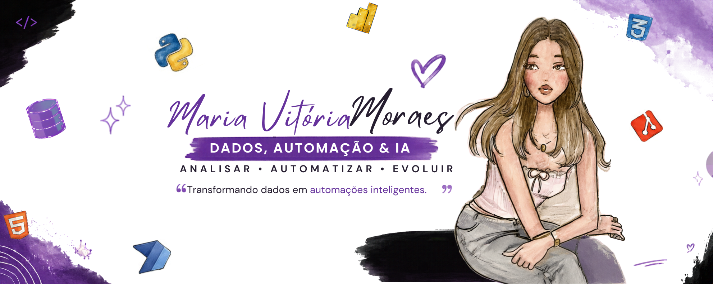

<div align="center">



# ~~ Meu Portfólio Pessoal ~~

[](#-tecnologias-utilizadas)
[](#-tecnologias-utilizadas)
[](#-tecnologias-utilizadas)

Um portfólio web responsivo desenvolvido para apresentar meu perfil, habilidades e projetos.

[🌍 Acessar o portfólio](https://seunome.github.io/portfolio)

</div>

---

## 👩‍💻 Sobre a Aluna

**Nome:** Maria Vitória Moraes  
**Disciplina:** Desenvolvimento de Sistemas I — Agenda 15  
**Tipo de projeto:** Portfólio pessoal responsivo

## 📖 Sobre o Projeto

Este projeto consiste no desenvolvimento de um **portfólio profissional web**, criado para apresentar meu perfil, destacar minhas principais habilidades técnicas e exibir os projetos desenvolvidos ao longo da minha formação.

O objetivo é simular uma apresentação profissional voltada ao mercado de trabalho, utilizando uma estrutura moderna, organizada e responsiva.

## 🛠️ Tecnologias Utilizadas

| Tecnologia | Finalidade |
|---|---|
| **HTML5** | Estruturação semântica das páginas |
| **CSS3** | Estilização, animações e personalização visual |
| **Bootstrap 5** | Sistema de grid, responsividade, navbar e componentes |

## 🌍 Acesso ao Site

O portfólio foi publicado por meio do **GitHub Pages**.

➡️ **Acesse aqui:** [https://seunome.github.io/portfolio](https://maryvictoi.github.io/portfolio-agenda15.github.io/)

## ⚙️ Funcionamento do Projeto

O site foi desenvolvido no formato de **Single Page Application (SPA)**, ou seja, todo o conteúdo é apresentado em uma única página, com navegação realizada por âncoras.

A interface é totalmente responsiva e se adapta a diferentes tamanhos de tela, como computadores, tablets e smartphones, por meio do sistema de grid do Bootstrap.

A navegação é feita por meio de uma **navbar fixa**, que direciona o usuário para as seguintes seções:

1. **Perfil** — Apresentação pessoal e fotografia.
2. **Habilidades** — Exibição das competências técnicas.
3. **Projetos** — Apresentação dos trabalhos desenvolvidos em formato de *cards*.
4. **Contato** — Links para redes profissionais e formas de contato.

## ✨ Recursos Extras Implementados

Além da estrutura básica do portfólio, foram adicionados os seguintes recursos:

- **Nova seção de Habilidades**, com barras de progresso para representar o nível de conhecimento em cada tecnologia.
- **Animação de interação (hover)** nos cards da seção de Projetos, tornando a interface mais dinâmica e moderna.

## 💻 Como os Recursos Foram Implementados

### Seção de Habilidades

A seção de habilidades foi implementada utilizando o componente **Progress** do Bootstrap.

Foram criadas barras visuais que representam o nível de domínio em diferentes tecnologias, como:

- HTML5
- CSS3
- JavaScript

### Animação de Hover nos Cards

A animação foi desenvolvida em **CSS puro**, no arquivo `style.css`, utilizando a pseudo-classe `:hover` nos cards da seção de projetos.

Foram aplicadas as seguintes propriedades:

```css
.card:hover {
  transform: translateY(-10px);
  box-shadow: 0 10px 20px rgba(0, 0, 0, 0.2);
  transition: 0.3s ease;
}
```

Com isso, ao passar o mouse sobre um card de projeto, ele se eleva levemente e recebe uma sombra mais intensa, criando um efeito visual mais interativo.

## 📁 Estrutura do Projeto

```text
portfolio/
├── index.html
├── style.css
├── img/
│   └── banner.png
└── README.md
```

## 🚀 Como Executar o Projeto

1. Faça o download ou clone este repositório.
2. Abra o arquivo `index.html` em qualquer navegador.
3. O site será carregado normalmente, sem necessidade de instalação de dependências.

```bash
git clone [https://github.com/seu-usuario/portfolio.git](https://github.com/seu-usuario/portfolio.git)
```

## 📌 Melhorias Futuras

- Adicionar novos projetos ao portfólio.
- Implementar um formulário de contato funcional.
- Incluir mais animações e efeitos visuais.
- Atualizar as habilidades conforme o aprendizado avança.

---

<div align="center">

Feito com 💜 por **Maria Vitória Moraes**

</div>
